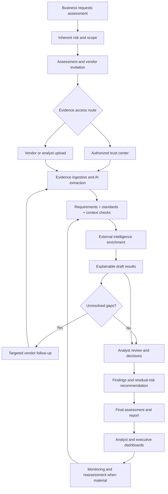

# LMA Vendor Trust Intelligence

## End-to-End Product Workflow & MVP Project Guide

**Project North Star:** Assess the evidence before you ask the questions.  
**Document purpose:** A readable, shared guide for product design, implementation, pilot testing, and prioritization.  
**Document status:** Target-state workflow and pilot scope; not a claim that every capability has already been implemented.  
**Version:** 1.0 · October 2026

**Current implementation boundary (M3D):** Evidence-Based Control Assurance is
the cross-control platform direction. The implemented **Control Assurance Review**
accepts applicable customer requirements independently of technical evaluator
availability. Registered synthetic examples include tested rules for privileged
MFA, transport encryption (TLS), and disaster-recovery testing, plus vulnerability
remediation without a specialist evaluator. The fallback keeps sources, concerns
and analyst decisions visible, with Needs Review when usable evidence exists or
Evidence Missing otherwise; it cannot infer passing or failure. Extensible workflow
coverage does not mean every control is technically automated or arbitrary documents
are understood. Standard references/mappings remain supplied metadata, not independently
verified compliance. All results are provisional, source-linked and require explicit analyst
review plus independent governance. See [implementation, measurements and limits](M3D_Evidence_Based_Control_Assurance.md).

---

## 1. Product mission

**LMA Vendor Trust Intelligence is an evidence-first third-party assessment platform.** It helps an organization assess a vendor faster by consuming the evidence the vendor already maintains, determining whether that evidence actually meets the organization's requirements, highlighting material risks and uncertainty, and preparing an explainable assessment for analyst review.

> **Primary product promise:** The vendor shares a trust center or evidence package; LMA reads and evaluates the content; the vendor answers only the remaining questions; the analyst reviews the exceptions and makes the final decision.

LMA's distinguishing value is **defensible evidence-to-requirement judgment**, not simply uploading files, summarizing reports, or automatically filling questionnaires.

### Non-negotiable principles

1. **Evidence first, questions second.** Analyze available assurance information before requesting new responses.
2. **Availability is not adequacy.** Possessing a SOC 2, pentest, certificate, or policy does not prove the associated requirement is satisfied.
3. **Missing evidence is not a failed control.** Label uncertainty accurately instead of inferring implementation failure.
4. **Standards and context matter.** Evaluate facts against organizational thresholds and the actual vendor use case.
5. **Explain every material conclusion.** Show the source, location, relevant facts, and reason for the outcome.
6. **Humans own decisions.** AI proposes; analysts confirm, challenge, request clarification, or document accepted risk.
7. **Simple on the surface.** Retain technical provenance, policy checks, and audit records behind a clear user experience.

---

## 2. End-to-end journey at a glance

**User-visible journey:** Request → Provide access → AI review → Clarify gaps → Analyst decision → Results → Monitor.

**Key actors:** Business requester, vendor representative, TPRM analyst, risk manager/approver, and executive viewer.

---

## 3. Stages 1–3 — Request, inherent risk, and assessment setup

### Stage 1 — Business intake

An internal business owner initiates a short vendor assessment request. This should collect business context, **not** ask the requester to answer security-control questions.

| Requested field | Why LMA needs it |
|---|---|
| Vendor name and service/product | Identify the relationship and assessed service |
| Business owner and department | Establish accountability and contact |
| Vendor contact name and email | Send the secure evidence request |
| Use case and business dependency | Understand operational exposure |
| Data types and sensitivity | Tailor privacy, encryption, and access requirements |
| Production, network, and privileged access | Identify elevated technical exposure |
| AI-enabled processing and geography | Apply relevant additional requirements |
| Business criticality and intended go-live | Prioritize depth and urgency |

**Output:** Vendor record, assessment request, business owner, vendor point of contact, and a documented use-case profile.

### Stage 2 — Inherent-risk assessment

LMA evaluates the relationship **before** giving credit for vendor safeguards. The calculation and risk-tier thresholds are organization-configurable.

**Illustrative result:** Inherent risk **High (78/100)**, driven by customer personal data, production processing, significant business dependency, and AI-enabled functionality.

**Output:** Inherent-risk tier and explainable key drivers. Inherent criticality remains visible even when validated controls later reduce the residual score.

### Stage 3 — Applicable assessment requirements

LMA selects an appropriate review depth and requirement set using the intake context. Organizations should be able to use their own security standards and policies; common frameworks can be mappings, not a substitute for organization-specific acceptance criteria.

Typical domains: governance; IAM and privileged access; encryption; vulnerability management and pentesting; secure development; monitoring; incident response; BCP/DR; privacy/data protection; fourth-party oversight; AI security, where relevant.

**Output:** An assessment workspace, ownership/due date, and a list of applicable, testable requirements with thresholds and acceptable evidence types.

---

## 4. Stages 4–5 — Vendor engagement and evidence collection

### Stage 4 — Secure vendor invitation

The analyst sends a **scoped, expiring link** to the vendor contact. The invitation makes evidence sharing the default rather than presenting a long questionnaire.

**Vendor choices, in recommended order:**

1. **Provide approved trust-center access** (public URL, authorized invitation, or supported access method).
2. **Upload an evidence package** (SOC 2, certificate, pentest summary, policies, etc.).
3. **Answer short, targeted questions** only for remaining information gaps after LMA reviews accessible evidence.

For the pilot, a vendor account need not be mandatory, but link expiration, authorization, access scoping, file protections, and audit records are mandatory design controls.

### Stage 5 — Trust-center and document intake

LMA should consume authorized evidence from public trust centers, access-controlled trust centers with approved access, analyst uploads, vendor uploads, and later approved reusable evidence.

**Practical limits:** Some portals require an NDA, authentication, a click-through agreement, or vendor-approved access. LMA must not bypass access controls or assume every trust center can be automatically crawled. Where direct import is not supported, vendor upload is the fallback.

**Output:** Evidence inventory listing document name/type, origin, service scope, issuance/audit period, applicable expiry/freshness dates, ingestion status, and accessible source location.

---

## 5. Stages 6–9 — The LMA intelligence engine

### Stage 6 — Parse, classify, and extract

LMA reads permitted files and pages, classifies artifacts, extracts text and metadata, and identifies specific claims, testing statements, exceptions, scope restrictions, and relevant dates.

**Example:** A SOC 2 Type II reports that privileged MFA was tested with no exceptions in a specified production SaaS environment during its audit period. LMA captures the fact **with its source location** instead of merely tagging the document “IAM.”

**Output:** Traceable, source-linked evidence facts and an extraction-confidence indication. Unreadable, scanned, restricted, or ambiguous materials are flagged for review rather than silently assumed complete.

### Stage 7 — Evaluate evidence quality and sufficiency

LMA applies five checks to every proposed evidence-to-requirement match.

| Check | Decision question |
|---|---|
| Relevance | Is the material about the specific requirement? |
| Scope | Does it cover this service, environment, entity, and population? |
| Freshness | Is the period or document age acceptable under our policy? |
| Sufficiency | Does it establish implementation or operating effectiveness, rather than just intent? |
| Standard compliance | Does the evidenced implementation meet the organization's technical or policy threshold? |

**Important distinctions:** A security policy can demonstrate policy intent, while a test result may demonstrate operation; a certification can cover only certain entities/services; a SOC 2 is evidence for its stated period and scope, not perpetual proof.

### Stage 8 — Standards and contextual intelligence

LMA compares extracted facts against specific requirement thresholds and considers how material an issue is for the vendor's use case. The organization controls the baseline; AI must not quietly invent or change acceptance criteria.

**TLS example:** Requirement: production connections must use TLS 1.2 or higher. Evidence says TLS 1.0 and TLS 1.2 are supported. **Proposed outcome: Partially Met / Risk Identified**, because deprecated TLS versions may remain enabled. Ask for configuration or test evidence confirming the production exposure and remediation status.

**Pentest example:** Source finding severity: Low. The finding affects administrative session controls, and the vendor has privileged production access to sensitive data. **LMA contextual assessment: Moderate (proposed)** with explanation; preserve the original severity separately.

**SOC 2 example:** The report's audit period ended outside the organization's freshness window. **Proposed outcome: Evidence Missing or Needs Review for current operating assurance**, with a reason and a request for a more recent report or acceptable interim assurance. A bridge letter is not automatically equivalent to a complete audit.

### Stage 9 — External intelligence enrichment

LMA may add materially relevant public information—disclosed incidents, material service outages, regulatory actions, security advisories, or vulnerability signals—and later ingest licensed external-risk feeds such as **BitSight** or **Black Kite** where customer access and commercial integration rights exist.

**Design rule:** External signals prompt contextual review; a cyber rating or headline must not automatically become a failed control or a confirmed vendor incident. Verify entity matching, publication date, reliability, business relevance, and whether the issue affects the assessed service.

---

## 6. Stages 10–12 — AI results, targeted questions, and analyst review

### Stage 10 — Explainable requirement-level results

Each applicable requirement receives one simple proposed result:

| User-facing result | Meaning |
|---|---|
| **Met** | Current, in-scope evidence sufficiently supports the requirement |
| **Partially Met** | Some aspects are supported, but specific elements remain unresolved |
| **Needs Review** | Evidence is conflicting, ambiguous, low confidence, or requires judgment |
| **Evidence Missing** | Available material cannot establish the required control or outcome |
| **Risk Identified** | Evidence affirmatively indicates a material weakness or nonconformance |

**Every result must include:** requirement and threshold; AI-proposed result; specific evidence and page/section/link; what the evidence actually says; why the threshold is or is not met; scope and freshness limitations; confidence/uncertainty; recommended next action; analyst action.

**Example requirement card**

> **Control Assurance Review — TLS — Provisional: Needs Review**
>
> **Requirement:** Customer policy v2026.1 requires enabled TLS ≥ 1.2 on every production endpoint.
>
> **Sources:** Exact configuration and dated scan quotations, with genuine locations.
>
> **Why:** The primary listeners meet the threshold; an alternate administrative listener is untested. A supported-protocol statement alone cannot establish enabled configuration or operation.
>
> **Action:** Request the alternate listener's configuration and protocol-rejection scan, then review the cited interpretations.

Citations and sections shown above are *illustrative placeholders*; real results must point to genuine source locations and must not invent page numbers or quotations.

### Stage 11 — Ask only gap-closing questions

Once evidence has been analyzed, LMA generates the smallest practical set of targeted questions that would resolve remaining decisions. The vendor's answers and new attachments return through the **same evaluation pipeline**.

**Illustrative requests:** latest DR test results; evidence that TLS 1.0/1.1 is disabled; status of a material pentest issue; in-scope backup handling; a current assurance report.

**Output:** Vendor-ready follow-up request with requirement, specific missing fact, acceptable answer/evidence, due date, and response status.

### Stage 12 — Analyst confirms the assessment

The analyst works from an **exception-focused queue**, prioritizing conflicting evidence, important findings, outdated artifacts, unclear scope, low-confidence AI conclusions, and unanswered vendor questions.

Allowed actions: **Accept**, **Challenge**, **Request Evidence**, and **Create Finding**. Risk acceptance or final approval requires separately authorized business/risk ownership under the organization's policy.

**Governance rule:** A generated result remains a recommendation until an authorized user confirms it; overrides retain the reason, actor, timestamp, and supporting material.

---

## 7. Stages 13–15 — Findings, residual risk, and final assessment

### Stage 13 — Findings and remediation requests

A confirmed weakness becomes a finding with a clear requirement, evidence source, issue, business context, severity, owner, target date, and status. The MVP needs lightweight tracking and export/integration readiness, **not** a replacement for ServiceNow or Jira.

### Stage 14 — Inherent versus residual risk

LMA shows **both** the relationship's inherent exposure and the remaining exposure after considering verified controls, open findings, and other permitted risk inputs. The approach must disclose policy guardrails, uncertainty, and whether a result is draft or approved.

| Scenario | Inherent | Residual | Interpretation |
|---|---|---|---|
| Effectively mitigated | Critical | Moderate | Substantial controls, but critical dependency remains |
| Persistent exposure | High | High | Controls do not sufficiently reduce remaining risk |
| Deterioration / elevated concern | Moderate | High | Additional weaknesses/signals increase exposure; review drivers and model assumptions |

**Important:** Risk-category movement is not itself proof that controls are effective. A lower residual score must be supported by validated assurance, and a higher residual outcome should have clearly identified additional drivers and a defined scoring policy.

### Stage 15 — Final assessment and result

The analyst finalizes requirements, records findings and risk rationale, and routes any required approval. The result presents both a concise summary and an evidence-backed detail export.

**Illustrative final result:** Acme Cloud · Enhanced Review · Inherent High (78) · Residual Moderate (46) · two material findings · recommendation: **Approve with remediation**. These figures and the decision are examples, not a prescribed calculation or an automatically authorized approval.

The report should include scope, evidence inventory, decisions by requirement, explanations and citations, gaps, findings, inherent/residual scores, risk drivers, analyst decisions, and follow-up commitments.

---

## 8. Two primary dashboards

### Analyst dashboard — “What should I work on today?”

Use an operational queue, not a collection of charts. Show **My Assessments**, stage, assigned owner, risk tier, due date/aging, trust-center access status, vendor submission status, AI parsing progress, evidence gaps, unresolved AI decisions, open findings, and the **next action**.

**Priority tiles:** Active assessments · Due this week · Waiting on vendor · AI reviews ready · High-risk findings · Overdue.

| Vendor | Inherent | Status | Main blocker | Next action |
|---|---|---|---|---|
| Acme Cloud | High | AI review ready | Pentest finding | Review contextual severity |
| CloudCo | Critical | Waiting on vendor | Trust-center invitation | Follow up on access |
| PayrollCo | Moderate | Near complete | Two evidence gaps | Send targeted questions |

### Executive dashboard — “Where are we exposed?”

Show the portfolio in a few decisions-focused views:

- **Exposure:** active vendors, critical relationships, high/critical residual risk, open critical findings, overdue reviews.
- **Inherent vs residual:** grouped risk distribution, high-inherent vendors still high residual, materially mitigated critical vendors, and deterioration with explanations.
- **Concentrations:** sensitive-data processors, production/privileged access, cloud/AI dependencies, critical services, geography and fourth-party exposure where supported.
- **Recurring weaknesses:** dominant control gaps and overdue remediation by risk and criticality.
- **Material signals:** current external incidents/ratings deterioration requiring review.
- **Program effectiveness:** completed assessments, cycle time, SLA attainment, evidence-answer rate, vendor questions avoided, and analyst acceptance/override rates.

**Do not hide critical inherent relationships simply because their residual rating is Low or Moderate.** Show both exposures and the reason for risk movement.

---

## 9. Monitoring and reassessment

Following completion, LMA monitors **material** changes within the capabilities and information sources the customer has enabled: assurance expiry, new evidence, vendor incident disclosures, significant ratings movement, critical findings, service or data-access changes, and review cadence.

An actionable alert explains **what changed, which requirements may be affected, why it matters, and the recommended action**. The analyst reopens the relevant requirements or initiates a targeted reassessment; internal policy lineage and revalidation mechanisms may remain hidden behind a simple “Assessment needs review” status.

**Example:** “The SOC 2 report is outside the allowed assurance period; 8 previously supported requirements may need current evidence. Request updated assurance.”

---

## 10. Simple user experience and navigation

Keep the pilot to five primary experiences:

| Screen | Primary user | Purpose |
|---|---|---|
| **Request Assessment** | Business requester | Submit relationship context and vendor contact |
| **Assessment Workspace** | Analyst | Track evidence, risk context, open gaps, and next action |
| **Vendor Evidence Portal** | Vendor | Grant trust-center access or upload documents; answer remaining questions |
| **AI Assessment Review** | Analyst | Review evidence-linked conclusions and exceptions |
| **Results & Dashboards** | Analyst / executive | Finalize a review and view portfolio outcomes |

Top navigation can stay familiar: **Dashboards · Vendors · Assessments · Evidence · Findings · Monitoring · Reports**. Advanced audit/lineage details belong behind an optional detail view.

**Language rule:** “Evidence Missing,” “Needs Review,” and “Assessment Needs Review” are preferred to internal status codes or RRA/RAE/RAV/RVC terminology.

---

## 11. Security, privacy, and reliability controls

These protections are part of a credible pilot, not optional future polish:

- **Authorized access only:** do not bypass trust-center authentication, NDAs, robots restrictions, or contractual data-use limits.
- **Scoped vendor links:** unique, expiring, access-controlled invitations; prevent cross-vendor and cross-assessment access.
- **Protected files:** validate type/size, scan uploads, encrypt storage/transit, restrict access, and set customer-controlled retention/deletion.
- **Source provenance:** preserve origin, capture/extraction date, document/version identifier, and exact location for citations.
- **Confidential AI handling:** follow enterprise data-processing settings; prevent cross-customer evidence leakage and avoid using customer documents for unrelated training without authorization.
- **Honest AI output:** distinguish verified statements from model interpretation; no fabricated citations, false certainty, or invented external allegations.
- **Audit trail:** record submissions, access grants, analyst decisions, overrides, approvals, and changes to published assessments.
- **Explicit approval:** automated analysis cannot silently approve a vendor or change the authoritative residual-risk result.

---

## 12. MVP scope and delivery sequence

The immediate goal is a **complete, testable vertical slice**, not every possible integration.

| Priority | Deliverable | Pilot proof |
|---|---|---|
| 1 | Business intake + inherent risk + assessment generation | Requester starts a correctly scoped review |
| 2 | Secure vendor link + uploaded evidence | Vendor submits evidence with minimal friction |
| 3 | AI parsing + cited evidence-to-requirement judgments | LMA identifies supported controls, gaps, and quality issues |
| 4 | Targeted follow-up + analyst accept/challenge | Analyst closes gaps without reviewing the entire questionnaire |
| 5 | Findings + residual-risk recommendation + final report | Completed, explainable assessment is exportable |
| 6 | Analyst and executive dashboards | Operational work and portfolio exposure are visible |
| 7 | Trust-center URL/import pilot | Authorized vendor-hosted evidence enters the same engine |

**Sequence note:** Trust-center access is central to the product vision; first ship upload-based analysis to validate the intelligence engine, then add supported trust-center ingestion without duplicating evaluation logic.

**Defer:** full procurement automation, sophisticated remediation workflows, many ratings connectors, autonomous risk approvals, elaborate policy-version screens, advanced revalidation case states, broad framework libraries, and deep dashboard customization.

---

## 13. Pilot demonstration: Acme Cloud

1. A business requester proposes Acme Cloud for customer analytics with sensitive-data processing.
2. LMA determines **High inherent risk (illustrative: 78)** and creates 52 applicable requirements.
3. The vendor receives a secure invitation and provides approved trust-center access; files may be uploaded as a fallback.
4. LMA discovers SOC 2, ISO certification, pentest, IAM policy, security policies, BCP, and architecture documents.
5. LMA extracts facts, verifies scope, dates, testing, and exceptions, then compares facts to the organization's requirements.
6. It flags possible deprecated TLS, a contextual pentest concern, and missing current DR-test evidence with source-linked reasons.
7. **Illustrative first-pass tally:** 39 Met · 6 Partially Met · 3 Needs Review · 3 Evidence Missing · 1 Risk Identified = **52 requirements**.
8. LMA prepares a short targeted vendor follow-up rather than a full questionnaire; new evidence is re-evaluated.
9. The analyst reviews exceptions, accepts or challenges AI results, and records material findings.
10. The final result displays **High inherent (78)** and **Moderate residual (46)**, with explanation, open findings, and approval conditions; the analyst and executive dashboards update.
11. Future material changes generate targeted review alerts instead of restarting the entire process without cause.

*All quantities, example controls, risk ratings, and improvement claims in this scenario are illustrative demo data—not pilot outcomes or validated product performance.*

---

## 14. How to evaluate the pilot

The central user test is: **Can LMA significantly reduce assessment effort while increasing consistency, transparency, and evidentiary quality?**

| Metric | Definition |
|---|---|
| Evidence-answer rate | Requirements adequately supported by available evidence ÷ applicable requirements |
| AI decision acceptance | AI conclusions accepted without substantive analyst change ÷ AI conclusions reviewed |
| Questions avoided | Baseline vendor questions not needed after evidence review, with a defined comparable baseline |
| Analyst review time | Actual analyst work minutes per completed assessment |
| Vendor effort | Time to grant access/respond and number of follow-up questions |
| Citation accuracy | Sampled conclusions with correct, accessible sources and faithful interpretations |
| Material miss/false-positive rate | Incorrectly accepted requirements and unnecessary risk flags found in expert review |
| Workflow completion | Pilot cases completed from intake through final decision without manual workarounds |

For early pilots, compare LMA to a **manual assessment of the same evidence and requirements**, preferably reviewed by an experienced TPRM analyst. Record both time savings and decision quality; speed without correctness is not success.

### Minimum pilot acceptance checks

- A requester can initiate a review and supply a vendor point of contact.
- A vendor can use a secure invitation to submit documents or supported trust-center access.
- LMA produces requirement-level proposed outcomes with genuine, navigable sources and reasons.
- LMA flags out-of-scope, stale, contradictory, or insufficient evidence instead of accepting it because it exists.
- LMA evaluates at least one technical threshold and one context-sensitive finding correctly.
- The vendor receives a reduced, specific follow-up set for genuine gaps.
- The analyst can accept/challenge, preserve rationale, and generate an assessment summary.
- Inherent and residual risk are shown separately with defensible drivers.
- Analysts and executives can find relevant work/exposure within a few clicks.

---

## 15. Project decision filter

Before adding a feature, ask:

1. Does it reduce evidence collection, interpretation, follow-up, or analyst decision effort?
2. Does it improve correctness, traceability, or contextual risk judgment?
3. Is it necessary to demonstrate the full intake-to-result pilot journey?
4. Can the user understand what to do and why within five seconds?

If not, **defer it**. Favor better evidence judgments and faster task completion over more screens, status transitions, or orchestration vocabulary.

---

## Final North Star

> **LMA Vendor Trust Intelligence helps organizations assess third parties faster by reading the security evidence vendors already maintain, deciding whether it actually satisfies the organization's requirements, weighing the specific relationship context, identifying only the gaps that matter, and giving analysts an explainable assessment to review rather than an entire assessment to perform manually.**

**Tagline:** *Assess the evidence before you ask the questions.*
